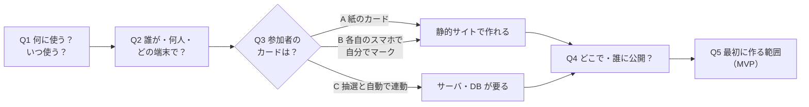

# BIZ-BINGO-001 ビンゴWebアプリ 事前要件整理（ドラフト）

## メタ情報

- Ticket: `T-001`
- Document ID: `PRE-T-001-v1`
- Status: `draft`
- Author: `tagashira`
- Reviewer: `Claude`
- Created: `2026-10-23`
- Updated: `2026-10-23`

## 0. 論点マップ（決める順番）

Q3 で作りの規模がほぼ決まる。Q1・Q2 はその判断材料。

### Q3 の判断材料

| 案 | 遊ぶ人の体験 | 必要な仕組み | 作る・公開する手間 |
|---|---|---|---|
| A 抽選だけ Web | 主催者が画面で番号を引き、プロジェクター等に大きく表示する。カードは紙 | 静的サイトのみ | 小 |
| B 参加者も Web カード | 参加者は URL を開くと自分のカードが出る。読み上げられた番号を自分でタップする | 静的サイトのみ（カードは各自のブラウザに保存） | 小〜中 |
| C 自動連動 | 引いた番号が全員のカードに自動で反映される。誰がリーチ・ビンゴかを主催者が見られる | リアルタイム同期（Firebase 等）＋ルーム管理 | 大 |

## 1. 背景と目的

- 背景:
- 目的:
- 使う予定の日（期限）:

## 2. スコープ

### 2.1 対象（MVP）

-

### 2.2 非対象（今回は作らない）

-

## 3. 業務要件（BIZ-ID カタログ）

> **BIZ-ID 命名規則**: `BIZ-BINGO-NN`
> BIZ-ID はユーザー視点の「何を実現するか」を表す。実装詳細はここに書かない。
> BIZ-ID は `specs/` の REQ-ID と 1:N で対応する。

| BIZ-ID | 業務要件概要（ユーザー視点） | 優先度 | 根拠・背景 |
|--------|---------------------------|--------|----------|
| BIZ-BINGO-01 | | | |

## 4. 受け入れ条件（Acceptance Criteria）

> 各 AC は BIZ-ID に紐付き、受け入れテストの検証観点になる。「正しく動く」等の曖昧語は使わない。

| AC-ID | 対応 BIZ-ID | 受け入れ条件 | 検証観点 |
|-------|------------|------------|---------|
| AC-001 | BIZ-BINGO-01 | | |

## 5. 影響範囲

> 新規アプリのため「既存への影響」ではなく「新たに必要になるもの」を書く。

### 5.1 API

- 要/不要: （Q3 で決まる。A・B なら不要の見込み）

### 5.2 DB・保存先

- 要/不要: （Q3 で決まる。A・B ならブラウザ内保存で足りる見込み）

### 5.3 エラーコード

- （API を持つ場合のみ）

## 6. 未決事項

- [ ] Q1 何に使う？いつ使う？（目的と期限）
- [ ] Q2 誰が・何人で・どの端末で使う？（主催者／参加者、PC・スマホ・プロジェクター）
- [ ] Q3 参加者のカードをどうする？（A 紙 / B Web で各自マーク / C 自動連動）→ ADR を起票
- [ ] Q4 どこで・誰に公開する？（GitHub Pages / Vercel / Firebase Hosting など）→ ADR を起票
- [ ] Q5 最初に作る範囲（MVP）と、後回しにするもの（演出・効果音・景品管理 など）
- [ ] Q6 ルールの細部（番号の範囲、カードのサイズ、フリーマス、ビンゴの判定）

## 7. 変更履歴

| 日付 | 変更内容 | 理由 |
|------|----------|------|
| 2026-10-23 | 初版作成（論点の洗い出しのみ） | プロジェクト準備 |
