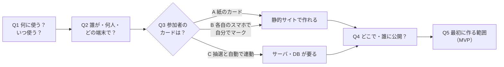

# BIZ-BINGO-001 ビンゴWebアプリ 事前要件整理（ドラフト）

## メタ情報

- Ticket: `T-001`
- Document ID: `PRE-T-001-v1`
- Status: `draft`
- Author: `tagashira`
- Reviewer: `Claude`
- Created: `2026-10-23`
- Updated: `2026-10-23`

## 0. 論点マップ（決める順番）

Q3 で作りの規模がほぼ決まる。Q1・Q2 はその判断材料。

### Q3 の判断材料

| 案 | 遊ぶ人の体験 | 必要な仕組み | 作る・公開する手間 |
|---|---|---|---|
| A 抽選だけ Web | 主催者が画面で番号を引き、プロジェクター等に大きく表示する。カードは紙 | 静的サイトのみ | 小 |
| B 参加者も Web カード | 参加者は URL を開くと自分のカードが出る。読み上げられた番号を自分でタップする | 静的サイトのみ（カードは各自のブラウザに保存） | 小〜中 |
| C 自動連動 | 引いた番号が全員のカードに自動で反映される。誰がリーチ・ビンゴかを主催者が見られる | リアルタイム同期（Firebase 等）＋ルーム管理 | 大 |

## 1. 背景と目的

- 背景: 対面の集まりでビンゴを行う予定がある
- 目的: 対面の集まりの会場で、その場でビンゴを進行するために使う
- 使う予定の日（期限）: 1か月以内（2026-11-23 頃まで。正確な日付は未定）
- 制約: 期限が短いため、当日に要る機能に絞る前提で仕様を決める（範囲は Q5 で決める）
- 利用シーン: 主催者が PC の画面をモニター（ディスプレイ）に映し、会場の参加者に見せる
- 参加人数: 100 人未満
- 参加者の端末: 使わない。参加者は紙のカードを使う（Q3・ADR-001）

## 2. スコープ

### 2.1 対象（MVP）

-

### 2.2 非対象（今回は作らない）

- 参加者用のカード画面（参加者は紙のカードを使う。ADR-001）
- 抽選と参加者カードの自動連動、アプリでのリーチ・ビンゴ判定（ADR-001）

## 3. 業務要件（BIZ-ID カタログ）

> **BIZ-ID 命名規則**: `BIZ-BINGO-NN`
> BIZ-ID はユーザー視点の「何を実現するか」を表す。実装詳細はここに書かない。
> BIZ-ID は `specs/` の REQ-ID と 1:N で対応する。

| BIZ-ID | 業務要件概要（ユーザー視点） | 優先度 | 根拠・背景 |
|--------|---------------------------|--------|----------|
| BIZ-BINGO-01 | 主催者は、抽選した番号を「ビンゴの球が抽選機から出てくる」映像でディスプレイに表示できる | （Q5 で決める） | 抽選をビジュアルで見せたいという要望（2026-10-23） |
| BIZ-BINGO-02 | 主催者は、ゲームを始めるときに抽選する番号を設定できる | （Q5 で決める） | 起動時に番号を設定して遊びたいという要望（2026-10-23） |

## 4. 受け入れ条件（Acceptance Criteria）

> 各 AC は BIZ-ID に紐付き、受け入れテストの検証観点になる。「正しく動く」等の曖昧語は使わない。

| AC-ID | 対応 BIZ-ID | 受け入れ条件 | 検証観点 |
|-------|------------|------------|---------|
| AC-001 | BIZ-BINGO-01 | | |

## 5. 影響範囲

> 新規アプリのため「既存への影響」ではなく「新たに必要になるもの」を書く。

### 5.1 API

- 不要（主催者の PC で完結するため。ADR-001）

### 5.2 DB・保存先

- サーバ側の DB は不要（ADR-001）
- ブラウザ内に保存するもの（設定・抽選の履歴など）の要否は Q5 で決める

### 5.3 エラーコード

- なし（API を持たないため）

## 6. 未決事項

- [x] Q1 何に使う？いつ使う？（目的と期限）→ 対面の集まりで使う。1か月以内（§1）
- [x] Q2 誰が・何人で・どの端末で使う？（主催者／参加者、PC・スマホ・プロジェクター）→ 主催者が PC をモニターに映して見せる。100 人未満。参加者の端末は Q3 で決まる（§1）
- [x] Q3 参加者のカードをどうする？（A 紙 / B Web で各自マーク / C 自動連動）→ A 紙のカード。アプリは主催者の抽選画面だけ（ADR-001）
- [ ] Q4 どこで・誰に公開する？（GitHub Pages / Vercel / Firebase Hosting など）→ ADR を起票
- [ ] Q5 最初に作る範囲（MVP）と、後回しにするもの（演出・効果音・景品管理 など）
  - 決まっていること: 抽選は抽選機から球が出てくる映像で見せる（BIZ-BINGO-01）
- [ ] Q6 ルールの細部（番号の範囲、カードのサイズ、フリーマス、ビンゴの判定）
  - 決まっていること: 抽選する番号は開始時に設定できる（BIZ-BINGO-02）
  - 未確認: 設定するのは「最大の番号（1〜N）」か「最小〜最大」か、それ以外か
  - 未確認: 紙のカードの番号と設定する番号をどうそろえるか（市販カードは一般に 1〜75）

## 7. 変更履歴

| 日付 | 変更内容 | 理由 |
|------|----------|------|
| 2026-10-23 | 初版作成（論点の洗い出しのみ） | プロジェクト準備 |
| 2026-10-23 | §1 に目的と期限を記入（Q1 決定） | 対面の集まりで 1か月以内に使うと決めたため |
| 2026-10-23 | §1 に利用シーン・人数を記入（Q2 決定）、§3 に BIZ-BINGO-01/02 を追加 | 抽選の見せ方と番号設定の要望が出たため |
| 2026-10-23 | §1・§2.2・§5 を更新（Q3 決定、ADR-001） | 参加者カードを紙にし、アプリを抽選画面だけにすると決めたため |
